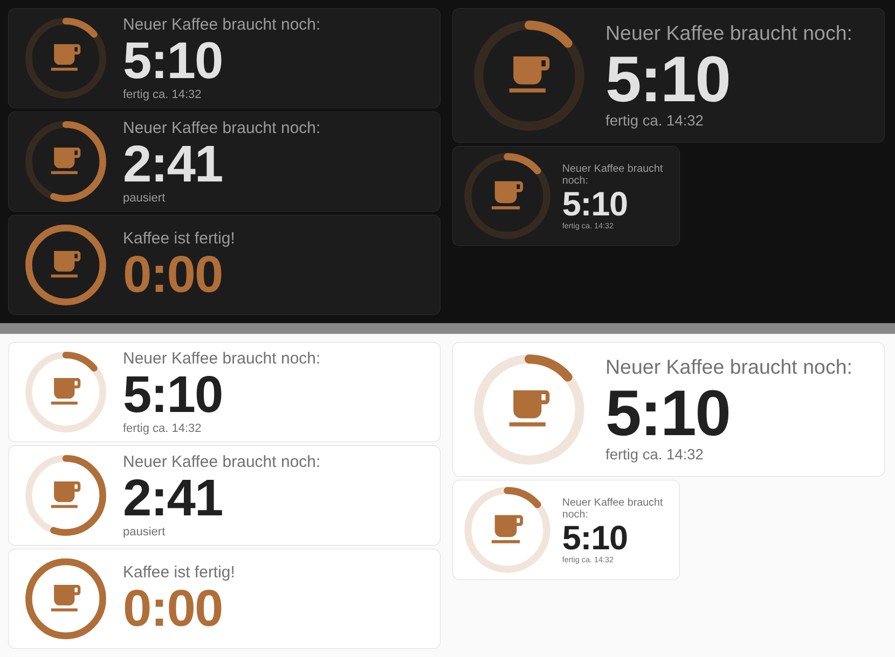

# Kaffee-Timer



Große Countdown-Anzeige für die Kaffeemaschine – gut lesbar auch auf einem Fernseher aus einiger
Entfernung. Zählt sekundengenau herunter (`m:ss`), zeigt den Fortschritt und optional die
voraussichtliche Uhrzeit („fertig ca. 14:32“). Bei 0:00 erscheint „Kaffee ist fertig!“.

Gedacht für 12 × 3 oder 12 × 4 Einheiten; alles skaliert mit der Kachelgröße. Die Sichtbarkeit steuerst
du in Home Assistant über die Sichtbarkeitsbedingung der Karte (z. B. Timer-Zustand = aktiv).

## Aufbau

Links ein **Fortschrittsring** um eine Kaffeetasse, der sich schließt, je näher der Kaffee ist.
Rechts der Text, darunter **groß die Restzeit** und klein „fertig ca. 14:32“. Ist der Timer pausiert,
steht dort „pausiert“.

## Datenquelle

Ein **Timer-Helfer** (`timer.*`): Endzeit (`finishes_at`) und Dauer (`duration`) werden direkt gelesen,
der Countdown läuft in der Karte sekundengenau – Home Assistant muss dafür nichts jede Sekunde senden.

## Visueller Editor

| Feld | Schlüssel | Standard |
|------|-----------|----------|
| Kaffee-Timer (Timer-Helfer) – Pflicht | `timer_entity` | – |
| Text | `title` | Neuer Kaffee braucht noch: |
| Text bei 0:00 | `done_text` | Kaffee ist fertig! |
| Farbe (Fortschritt) | `color` | Kaffeebraun |
| „fertig ca. HH:MM“ anzeigen | `show_end_time` | an |

## YAML (nur zur Info)

```yaml
type: custom:coffee-timer-card
timer_entity: timer.kaffee
grid_options:
  columns: 12
  rows: 3
visibility:
  - condition: state
    entity: timer.kaffee
    state: active
```
