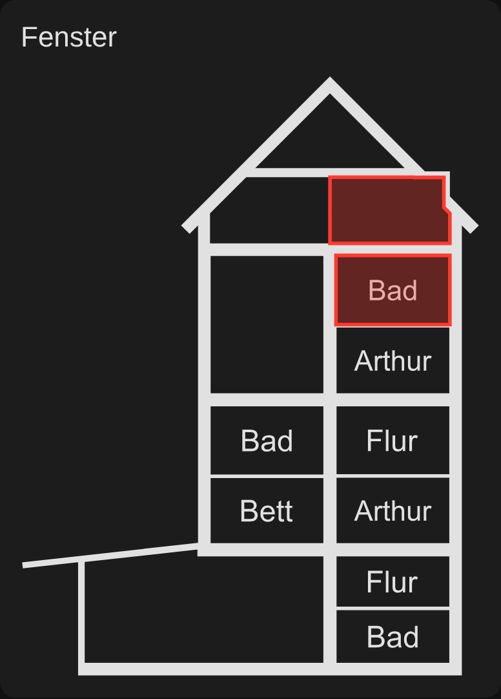

# Fenster-Haus



Seitenansicht des Hauses. Jeder Raum wird **rot (pulsierend)**, sobald eine der ihm zugeordneten
Entitäten offen ist (Zustand `on` oder `open`). Pro Raum können beliebig viele Entitäten gewählt
werden (z. B. mehrere Fensterkontakte). Tippen auf einen Raum öffnet die More-Info-Ansicht des
offenen Fensters.

Das Dachgeschoss ist geteilt: **rechts = Erker**, **links = Dachfenster**, darüber die **Spitze (Gaube)**.

Ursprünglich aus [Arthur2560/Fenster](https://github.com/Arthur2560/Fenster) übernommen – Typ und
YAML-Format sind gleich geblieben, bestehende Dashboards funktionieren also weiter.

## Größe im Sections-Dashboard

Die Zeichnung passt sich proportional in die eingestellte Kachelgröße ein – sie ragt nie über die
Kachel hinaus. Die Höhe kannst du im Layout-Tab der Karte oder per YAML frei festlegen, auch über
die Standardgröße hinaus:

```yaml
grid_options:
  columns: 12
  rows: 10
```

## Visueller Editor

Auswählbar sind Entitäten der Domains `binary_sensor`, `cover` und `input_boolean` (Mehrfachauswahl).

| Abschnitt          | Feld                             | Schlüssel      |
|--------------------|----------------------------------|----------------|
| –                  | Titel (optional)                 | `title`        |
| Dachgeschoss       | Spitze (Gaube)                   | `spitze`       |
|                    | Dachgeschoss links (Dachfenster) | `dach_links`   |
|                    | Dachgeschoss rechts (Erker)      | `dach_rechts`  |
| Obergeschoss       | Oben links                       | `oben_links`   |
|                    | Oben Bad                         | `oben_bad`     |
|                    | Oben Arthur                      | `oben_arthur`  |
| Mittleres Geschoss | Mitte Flur                       | `mitte_flur`   |
|                    | Mitte Arthur                     | `mitte_arthur` |
|                    | Mitte Bett                       | `mitte_bett`   |
|                    | Mitte Bad                        | `mitte_bad`    |
| Erdgeschoss        | Unten Flur                       | `unten_flur`   |
|                    | Unten Bad                        | `unten_bad`    |
|                    | Unten links                      | `unten_links`  |

## YAML (nur zur Info)

```yaml
type: custom:fenster-haus-card
title: Fenster
zones:
  spitze: [binary_sensor.fenster_gaube]
  dach_links: [binary_sensor.dachfenster_1, binary_sensor.dachfenster_2]
  dach_rechts: [binary_sensor.erker_links, binary_sensor.erker_rechts]
  oben_bad: [binary_sensor.fenster_bad_oben]
```
