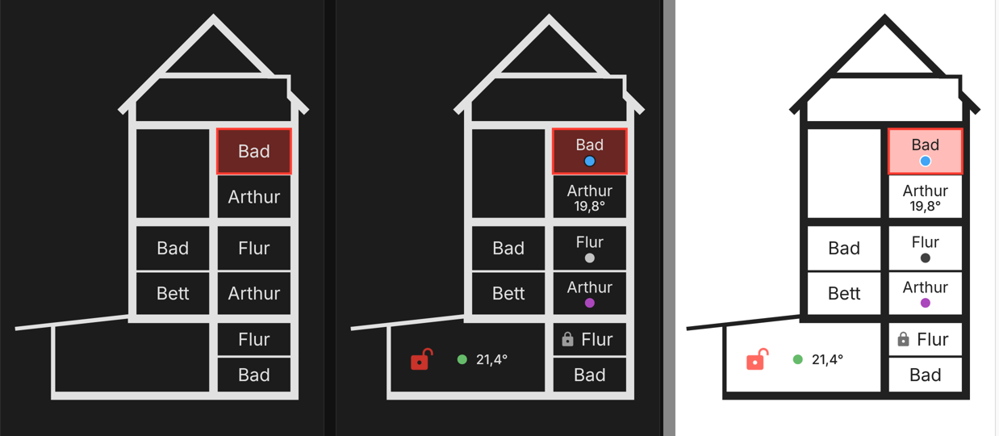

# Fenster-Haus (Test)



*Links ohne Zusätze, Mitte mit Zusätzen (dunkles Theme), rechts mit Zusätzen (helles Theme).*

Test-Variante der [Fenster-Haus-Karte](../fenster-haus-card): gleiche Zeichnung und gleiche
Fenster-Funktion, aber die Raumnamen sind **echter Text** (im Editor umbenennbar) und pro Raum lassen
sich weitere Dinge anzeigen. **Alles ist optional** – ohne Zusätze sieht die Karte aus wie das Original.

## Pro Raum

| Funktion | Anzeige |
|----------|---------|
| Fenster / Türen | Raum wird rot pulsierend, wenn eine Entität offen ist (wie im Original) |
| Präsenzsensor | grauer Punkt unter dem Raumnamen, wenn jemand da ist |
| Personen | farbiger Punkt pro Person, die sich im Raum aufhält (ersetzt den grauen Punkt) |
| Temperatur | Wert als Text, z. B. „21,4°“ (Tippen öffnet den Sensor) |
| Schloss | linke Raumhälfte: **graues geschlossenes Schloss** = abgeschlossen, **rotes pulsierendes offenes Schloss** = offen |
| Beschriftung | eigener Raumname, „-“ = kein Text |

Sobald in einem Raum Präsenz, Temperatur oder ein Raumname für Personen eingestellt ist, rutscht der
Raumname etwas nach oben, damit darunter Platz für Punkte und Temperatur ist. Mit Schloss rückt der
Inhalt nach rechts.

**Schloss-Entität:** `lock.*` (locked = abgeschlossen), `binary_sensor.*` (an = offen) oder
`input_boolean.*` (an = abgeschlossen) – so lässt sich das schon mit einem Helfer vorbereiten.

## Personen

Bis zu 3 Personen mit Name, Farbe und einer **Raum-Entität**, deren Zustand der aktuelle Raum ist
(z. B. Bermuda, ESPresense oder ein `input_select`). Die Person wird in dem Raum angezeigt, dessen
**„Raumname für Personen“** zum Zustand passt (Groß-/Kleinschreibung egal, mehrere Namen mit Komma).

Beispiel: Person 1 → `sensor.arthur_raum` hat den Zustand `Wohnzimmer`; beim Raum „Erdgeschoss links“ steht
als Raumname `Wohnzimmer, Wintergarten` → blauer Punkt im Erdgeschoss links.

## YAML (nur zur Info)

```yaml
type: custom:fenster-haus-test-card
zones:
  oben_bad: [binary_sensor.fenster_bad_oben]
person1_name: Arthur
person1_entity: sensor.arthur_raum
unten_links_area: Wohnzimmer, Wintergarten
unten_links_temperature: sensor.wohnzimmer_temperatur
unten_links_lock: lock.gartentuer
mitte_flur_presence: binary_sensor.flur_praesenz
grid_options:
  columns: 12
  rows: 10
```
