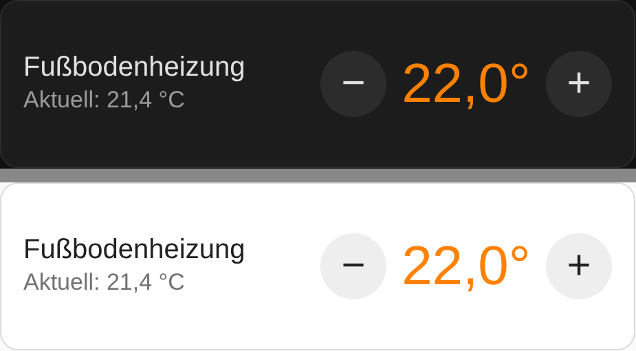

# Fußbodenheizung



Einfache Thermostat-Karte: links „Fußbodenheizung“ und darunter die aktuelle Raumtemperatur,
rechts die eingestellte Solltemperatur mit **−** und **+** (Standard: 0,5-°C-Schritte).

- Der neue Wert wird sofort angezeigt und **1 Sekunde nach dem letzten Tipp** an das Thermostat
  gesendet – mehrfaches Tippen erzeugt also nur einen Befehl.
- Solltemperatur **orange**, solange die Heizung gerade heizt (`hvac_action: heating`).
- Ist das Thermostat aus, steht „· Aus“ hinter der aktuellen Temperatur.
- Grenzen `min_temp` / `max_temp` des Thermostats werden eingehalten.
- Tippen auf den Text öffnet die Detailansicht des Thermostats.
- Größe skaliert mit der Kachel (Standard 12 × 2, ab 1 Zeile möglich).

## Visueller Editor

| Feld | Schlüssel | Standard |
|------|-----------|----------|
| Thermostat (Klima-Entität) – Pflicht | `climate_entity` | – |
| Raumtemperatur-Sensor (optional) | `temperature_entity` | aktuelle Temperatur des Thermostats |
| Überschrift | `title` | Fußbodenheizung |
| Schrittweite (°C) | `step` | 0,5 |

## YAML (nur zur Info)

```yaml
type: custom:floor-heating-card
climate_entity: climate.fussbodenheizung_wohnzimmer
temperature_entity: sensor.wohnzimmer_temperatur
```
