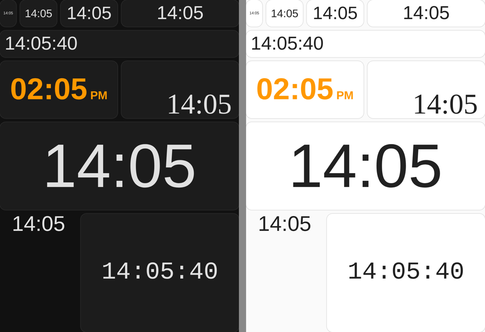

# Digitaluhr



Einfache Digitaluhr, aber frei konfigurierbar – ohne Entitäten. Anders als die HA-eigene Uhr ist
**jede Kachelgröße von 1 × 1 bis 12 × 12** möglich (Layout-Tab bzw. `grid_options`).

- Position horizontal (links / Mitte / rechts) und vertikal (oben / Mitte / unten)
- Textgröße als Anteil der Kachelhöhe; passt die Uhrzeit nicht in die Breite, wird sie automatisch kleiner
- Schriftart (Liste oder eigener Name), Schriftstärke, Schriftfarbe
- 24 h oder 12 h, Sekunden, AM/PM, führende Null
- Optional ohne Kartenhintergrund
- Tickt genau zum Minuten- bzw. Sekundenwechsel

## Visueller Editor

| Feld | Schlüssel | Standard |
|------|-----------|----------|
| Format | `hour_format` | `24` |
| Sekunden anzeigen | `show_seconds` | aus |
| Führende Null (08:05) | `leading_zero` | an |
| AM/PM anzeigen (12 h) | `show_ampm` | an |
| Horizontal | `align` | `center` |
| Vertikal | `valign` | `center` |
| Textgröße (Anteil der Kachelhöhe, %) | `size` | 70 |
| Schriftart | `font_family` | Theme-Schrift |
| Schriftstärke | `font_weight` | `400` |
| Schriftfarbe | `color` | Theme-Textfarbe |
| Ohne Kartenhintergrund | `transparent` | aus |

## YAML (nur zur Info)

```yaml
type: custom:free-clock-card
align: left
size: 80
font_weight: "300"
grid_options:
  columns: 6
  rows: 1
```
