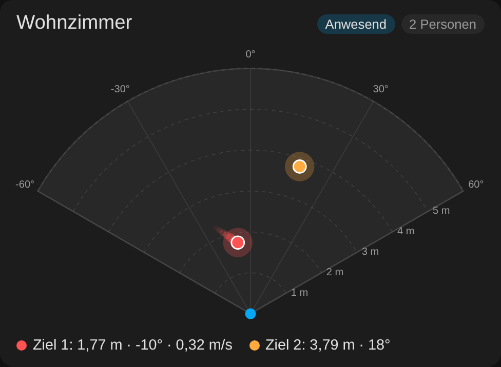

# LD2450 Radar



Radar-Ansicht für den **HLK-LD2450** (z. B. über ESPHome). Der Messbereich wird als Fächer
(Kreisausschnitt) in den Farben des Home-Assistant-Themes dargestellt – Sensor unten in der Mitte, Blickrichtung nach oben. Aus den
X/Y-Koordinaten der bis zu drei Ziele werden Punkte berechnet, die sich mit einer kurzen Spur durch
den Raum bewegen.

- Messwinkel und Reichweite einstellbar (LD2450: ca. 120° / 6 m)
- Entfernungsringe pro Meter, Winkellinien alle 30°
- Unter dem Radar: Entfernung, Winkel und (optional) Geschwindigkeit je Ziel
- Einheiten mm, cm und m werden automatisch erkannt
- Ein Ziel mit X = 0 und Y = 0 gilt als „nicht erkannt“ (so meldet es der LD2450)

## Visueller Editor

Alle Sensor-Felder zeigen nur `sensor`-Entitäten der ESPHome-Integration.

| Abschnitt | Feld | Schlüssel | Standard |
|-----------|------|-----------|----------|
| – | Titel (optional) | `title` | – |
| Ziel 1 | Koordinate X (Pflicht) | `target1_x` | – |
| | Koordinate Y (Pflicht) | `target1_y` | – |
| | Geschwindigkeit (optional) | `target1_speed` | – |
| | Farbe | `target1_color` | Rot |
| Ziel 2 | Koordinate X / Y / Geschwindigkeit / Farbe | `target2_x`, `target2_y`, `target2_speed`, `target2_color` | Orange |
| Ziel 3 | Koordinate X / Y / Geschwindigkeit / Farbe | `target3_x`, `target3_y`, `target3_speed`, `target3_color` | Blau |
| Status (optional) | Anwesenheit (Binärsensor) | `presence_entity` | – |
| | Anzahl Ziele (Sensor) | `target_count_entity` | – |
| Darstellung | Reichweite (m) | `max_range` | 6 |
| | Messwinkel (°) | `fov` | 120 |
| | Spurlänge (Punkte, 0 = aus) | `trail` | 8 |
| | Entfernung / Winkel anzeigen | `show_info` | an |
| | Links/Rechts spiegeln | `mirror` | aus |

**Tipp:** Wenn sich eine Person nach links bewegt, der Punkt aber nach rechts wandert, „Links/Rechts
spiegeln“ einschalten.

## YAML (nur zur Info)

```yaml
type: custom:ld2450-radar-card
title: Wohnzimmer
target1_x: sensor.ld2450_target_1_x
target1_y: sensor.ld2450_target_1_y
target1_speed: sensor.ld2450_target_1_speed
target2_x: sensor.ld2450_target_2_x
target2_y: sensor.ld2450_target_2_y
target3_x: sensor.ld2450_target_3_x
target3_y: sensor.ld2450_target_3_y
presence_entity: binary_sensor.ld2450_presence
max_range: 5
```
