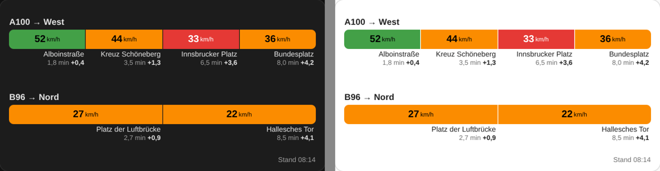
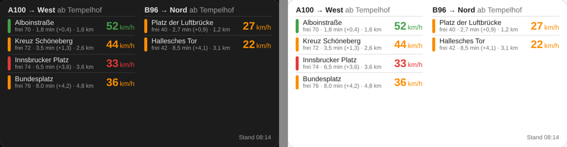
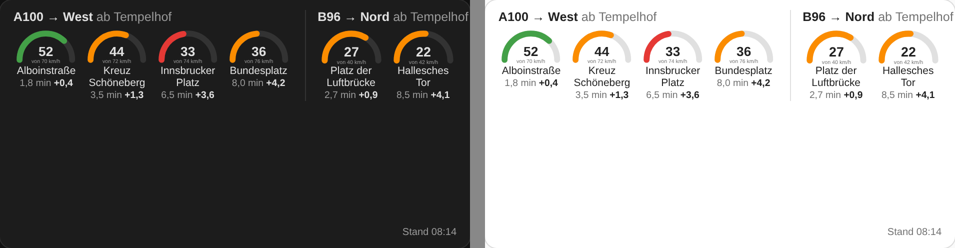
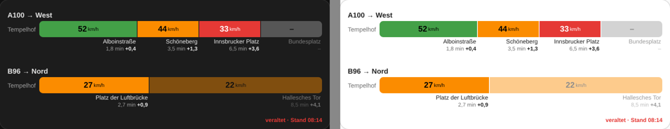

# Verkehrslage

Verkehrslage ab Tempelhof für die Sensoren aus dem Heimserver-Skript (`sensor.verkehr_…`): pro Ziel
die **aktuelle Durchschnittsgeschwindigkeit** (Hauptangabe), Vergleich zur freien Fahrt, Fahrzeit,
Verzögerung und Streckenlänge. Die Karte liest nur die Sensoren – sie rechnet nichts Wichtiges selbst
und aktualisiert sich mit den normalen Zustandsänderungen.

Gedacht für 12 × 3 oder 12 × 4 Einheiten; alles skaliert mit der Kachel. Das Streckenband braucht
auf dem iPad am besten 4 Zeilen.

## Designs (`design`)

**Streckenband (`strip`)** – pro Strecke ein Balken über die volle Breite, alle Abschnitte gleich breit,
farbig mit der Geschwindigkeit darin; darunter Haltepunkt, Fahrzeit und Verzögerung.



**Liste (`list`)** – kompakte Tabelle, Strecken nebeneinander; Geschwindigkeit groß und farbig,
darunter „frei 76 · 8,0 min (+4,2) · 4,8 km“.



**Tacho (`gauge`)** – pro Ziel ein Halbkreis, gefüllt im Verhältnis zur freien Geschwindigkeit.



## Farben

Standard: nach Verhältnis aktuelle ÷ freie Geschwindigkeit – unter 45 % **rot** (Stau), unter 70 %
**orange** (zähfließend), unter 90 % **grün**, darüber **hellgrün** (frei). Schwellen im Editor
einstellbar. Alternativ nach `worst_los` (0 rot · 1 orange · 2 grün · 3 hellgrün).

## Fehlerfälle

- Sensor `unavailable`/`unknown` oder fehlend → grau, „–“ bzw. „fehlt“
- Fehlende Attribute → die jeweilige Angabe wird weggelassen; `worst_los: null` → grau (nur bei Färbung nach LOS)
- `last_updated` älter als 15 Minuten (einstellbar) → Eintrag blass, unten rot „veraltet · Stand HH:MM“



## Visueller Editor

| Abschnitt | Feld | Schlüssel | Standard |
|-----------|------|-----------|----------|
| – | Design | `design` | Streckenband |
| – | Titel (optional) | `title` | – |
| Strecke 1 / 2 | Bezeichnung der Strecke | `route1_title` / `route2_title` | A100 → West / B96 → Nord |
| | Startpunkt (bei Liste und Tacho im Titel) | `route1_start` / `route2_start` | Tempelhof |
| | Ziel 1–6 – Sensor (in Fahrtreihenfolge) | `routeN_entity1` … `routeN_entity6` | – |
| | Ziel 1–6 – Name (optional) | `routeN_name1` … `routeN_name6` | aus dem Sensornamen |
| Farben & Aktualität | Färbung | `color_mode` | `ratio` |
| | Rot / Orange / Grün unter (Anteil) | `ratio_red` / `ratio_orange` / `ratio_green` | 0,45 / 0,7 / 0,9 |
| | Veraltet nach (min) | `stale_minutes` | 15 |
| | „Stand HH:MM“ anzeigen | `show_updated` | an |

Es lassen sich beliebig wenige Ziele eintragen – z. B. nur ein Sensor oder nur die A100.

## YAML (nur zur Info)

```yaml
type: custom:traffic-card
design: strip
route1_entity1: sensor.verkehr_a100_alboinstrasse
route1_entity2: sensor.verkehr_a100_kreuz_schoeneberg
route1_name2: Schöneberg
route1_entity3: sensor.verkehr_a100_innsbrucker_platz
route1_entity4: sensor.verkehr_a100_bundesplatz
route2_entity1: sensor.verkehr_b96_platz_der_luftbruecke
route2_entity2: sensor.verkehr_b96_hallesches_tor
grid_options:
  columns: 12
  rows: 4
```
