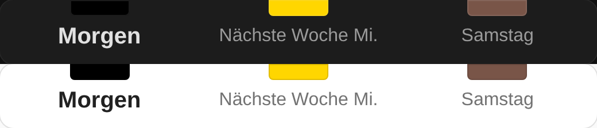

# Müllabholung



Flache Karte (12 × 1 Einheiten im Sections-Dashboard) für die Integration
[Waste Collection Schedule](https://github.com/mampfes/hacs_waste_collection_schedule).
Pro Tonne ein farbiger Streifen am oberen Rand, darunter der nächste Abholtag – ohne Icons, ohne Titel.

| Abholung | Anzeige |
|----------|---------|
| heute | **Heute** (fett, größer) |
| morgen | **Morgen** (fett, größer) |
| später in dieser Woche | Mittwoch |
| in der nächsten Woche | Nächste Woche Mittwoch (bei wenig Platz: Nächste Woche Mi. / Nä. Woche Mi.) |
| später | In 12 Tagen |

Wochen beginnen am Montag. Tippen auf eine Tonne öffnet die Detailansicht des Sensors.

Das Datum wird aus den Sensor-Attributen gelesen (Standard-Format der Integration, z. B.
`2026-11-26: Restmüll`). Alternativ funktionieren das Attribut `daysTo` (Option `add_days_to`) oder
ein Zustand wie „Restmüll in 3 days“, „in 3 Tagen“, „Morgen“ oder ein Datum.

## Visueller Editor

| Abschnitt | Feld | Schlüssel | Standard |
|-----------|------|-----------|----------|
| Restmüll | Sensor / Farbe | `restmuell_entity`, `restmuell_color` | schwarz |
| Wertstoffe | Sensor / Farbe | `wertstoffe_entity`, `wertstoffe_color` | gelb |
| Biomüll | Sensor / Farbe | `bio_entity`, `bio_color` | braun |
| Papier (optional) | Sensor / Farbe | `papier_entity`, `papier_color` | blau |
| Darstellung | Streifenbreite (px) | `stripe_width` | 52 |
| | Streifendicke (px) | `stripe_height` | 14 |
| | Nach Abholtag sortieren | `sort_by_date` | aus |

Tonnen ohne Sensor werden ausgeblendet. Die Sensor-Auswahl zeigt nur Sensoren der
Waste-Collection-Schedule-Integration.

## YAML (nur zur Info)

```yaml
type: custom:waste-collection-card
restmuell_entity: sensor.restmuell
wertstoffe_entity: sensor.wertstoffe
bio_entity: sensor.biomuell
```
