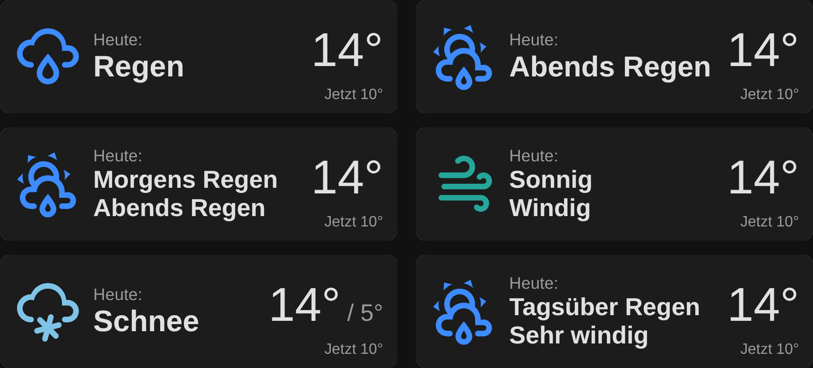

# Wetter Heute



Kompakte Wetterkarte mit **großem, schnell lesbarem Text** – gedacht für Wand-Tablets (z. B. iPad).
Nicht höher als die Standard-Wetterkarte (2 Rasterzeilen in Sections-Dashboards).

- **Links:** Icon für das Wetter der nächsten 12 Stunden (Regen, Schnee, Gewitter, Wind, Sonne, …)
- **Mitte:** „Heute:“ und darunter 1–2 Stichworte, z. B.
  - `Regen` – regnet den Großteil der Zeit
  - `Abends Regen` – nur in einem Tagesabschnitt
  - `Morgens Regen` / `Abends Regen` – zwei getrennte Abschnitte, zwei Zeilen
  - `Tagsüber Regen`, `Zeitweise Regen`, `Morgen früh Regen`
  - `Windig` / `Sehr windig`, `Sonnig`, `Teils bewölkt`, `Bewölkt`, `Nebel`, `Schnee`, `Gewitter`, …
- **Rechts:** vorhergesagte Höchsttemperatur des Tages (optional mit Tiefstwert)
- **Unten rechts:** aktuelle Temperatur
- Tippen öffnet die Detailansicht der Wetter-Entität

Tagesabschnitte: Morgens 5–10 Uhr · Mittags 10–14 · Nachmittags 14–18 · Abends 18–22 · Nachts 22–5 ·
„Morgen früh“ = Morgen des Folgetags.

Die Vorhersage wird wie bei der HA-eigenen Wetterkarte live abonniert (stündlich + täglich). Liefert
die Integration keine stündliche Vorhersage, zeigt die Karte den aktuellen Zustand.

## Visueller Editor

| Abschnitt | Feld | Schlüssel | Standard |
|-----------|------|-----------|----------|
| – | Wetter-Entität (Vorhersage) – Pflicht | `weather_entity` | – |
| – | Außentemperatur-Sensor (optional) | `temperature_entity` | Wert der Wetter-Entität |
| – | Überschrift | `title` | Heute |
| Vorhersage & Schwellwerte | Zeitraum (h) | `hours` | 12 |
| | Regen ab Wahrscheinlichkeit (%) | `precipitation_probability` | 60 |
| | „Windig“ ab (km/h) | `wind_threshold` | 30 |
| | „Sehr windig“ ab (km/h) | `strong_wind_threshold` | 50 |
| | Tiefsttemperatur anzeigen | `show_low` | aus |

## YAML (nur zur Info)

```yaml
type: custom:weather-today-card
weather_entity: weather.forecast_home
temperature_entity: sensor.aussentemperatur
```
